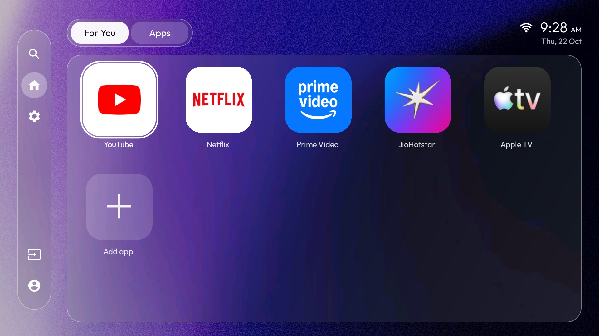
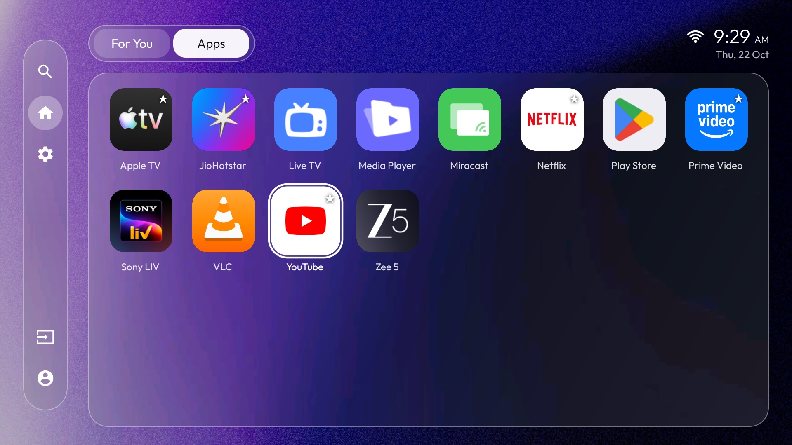
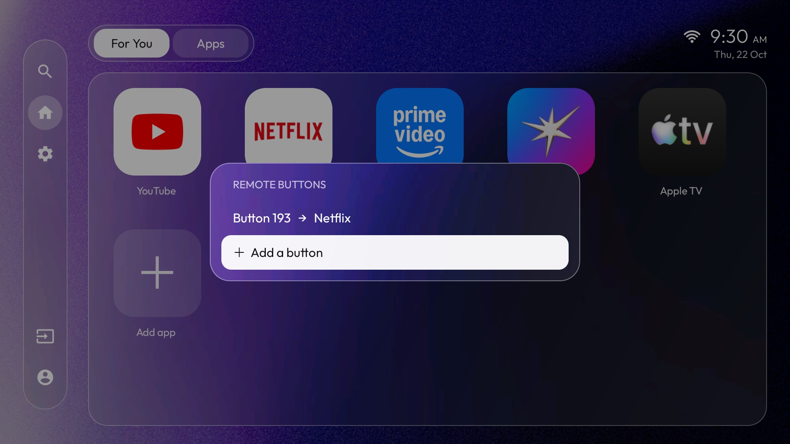
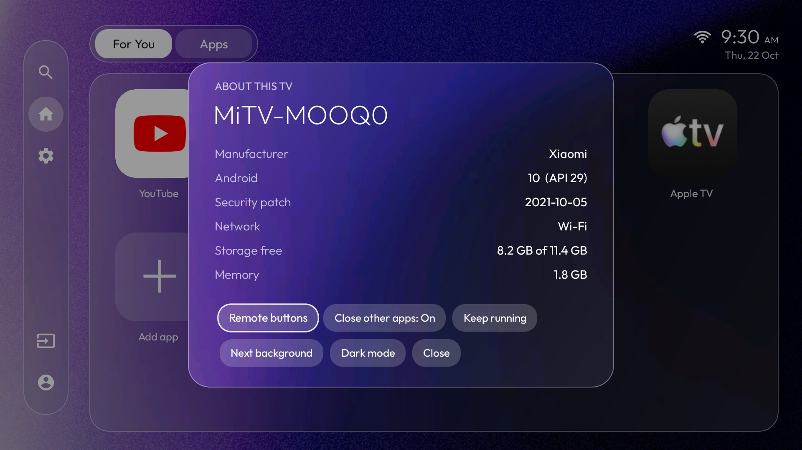

# The MinimalTV Project

A faster, quieter Android TV: a small home screen, a safe debloat, and a working remote. One toolkit for any Android TV
or Google TV, not one brand.

TV makers load their sets with their own home screens, ad rows, trackers and background services, and the cheap ones
ship with 1 to 2 GB of RAM to run it all. The result is a slow TV. This project replaces the home screen, switches off
what you do not need (nothing is uninstalled, everything can be undone), and makes the remote's special buttons work
again.

**Set up your own TV, no helper needed.** Every step is written out in plain language, starting on the TV itself, so you can
do this without Claude, ChatGPT or any other AI, and without knowing anything about Android first.

<p align="center">
  
  
  
  
</p>

## What you get

- **MinimalTV, a home screen** (`launcher/`). Two tabs: For You (your favourite apps) and Apps (everything installed).
  A frosted-glass look over a slowly drifting photo, search, inputs (HDMI, AV, tuner), light and dark mode. No network
  permission, no ads, no accounts.
- **Files, a file manager for the remote** (`files/`, [docs/FILES.md](docs/FILES.md)). Browse internal storage and USB
  drives, copy, move, rename and delete, all with the D-pad. A separate app, so it is optional.
- **A debloat that can be undone** (`scripts/`, `packages/`). Disables telemetry, feedback uploaders, setup wizards,
  backup helpers, the stock home screens and, with a brand profile, the manufacturer's own bloat. Dry run first,
  automatic backup, one command to restore.
- **Speed tweaks that need no root.** Faster animations, background limits for streaming apps, trimmed caches.
- **Remote buttons that work.** On the TV, press a button and choose what it does: open the home screen, the Apps tab
  or any app. No key codes to look up, no code to edit. Optionally closes the app you were in when you open another,
  so apps do not pile up in a small TV's memory.

## Will it work on my TV?

| Part | Needs | Verified on |
| --- | --- | --- |
| Home screen | Android TV or Google TV, Android 8.0 or newer (API 26) | Android 10, Xiaomi |
| Speed tweaks | Android 8.0 or newer | Android 10, Xiaomi |
| Remote buttons | A remote whose extra buttons send key codes to Android (most do) | One Mi TV remote |
| Debloat, generic lists | Any Google-certified Android TV: Google and Android packages only | Android 10, Xiaomi |
| Debloat, brand profiles | Xiaomi / Mi TV is included. For other brands see [docs/PROFILES.md](docs/PROFILES.md) | Xiaomi only |

**What is and is not tested.** Everything here was developed and checked on one TV (a Xiaomi MiTV-MOOQ0, Android 10,
1 GB of RAM). The home screen is built to the Android 8+ API level and passes Android's compatibility lint, but I have
not run it on other brands. The scripts are written so that a wrong guess is cheap: they skip packages your TV does not
have, run as a dry run first, back up before changing anything and undo everything with one command.

**Not supported:** Samsung (Tizen), LG (webOS), Roku and other non-Android TV platforms have no `adb` and no Android
launchers. Amazon Fire TV is Android underneath and the debloat commands work, but Amazon does not let you replace its
home screen; that is untested here.

**Different brand?** The home screen, tweaks and remote buttons need nothing brand-specific. For the debloat, run
`./scripts/scan.sh` to list your TV's own packages and follow [docs/PROFILES.md](docs/PROFILES.md) to write a profile.
Profiles for other brands are very welcome as pull requests.

## Before you install (about 10 minutes)

Do this once. It gets the TV and your computer ready. (More detail, other computers and fixes: the
[complete install guide](docs/INSTALL.md).)

### Part 1: on the TV (use the remote)

| # | Do this | You should see |
| --- | --- | --- |
| 1 | Connect the TV to the **same Wi-Fi or router as your computer**: **Settings** (gear icon, top right of the home screen), **Network & Internet**, pick your Wi-Fi, type the password. Or plug in an Ethernet cable | "Connected" |
| 2 | **Settings**, **Network & Internet**, press OK on your network. **Write down the IP address** (like `192.168.1.50`). If you do not see it: **Settings, Device Preferences, About, Status** | four numbers with dots |
| 3 | **Settings**, **Device Preferences**, **About**. (Google TV: **Settings, System, About**) | the About list |
| 4 | Scroll to **Build** (it may be called **Build number**, **OS build** or **Android TV OS build**) and press **OK 7 times** | "You are now a developer!" |
| 5 | Press **Back** once and open **Developer options** | the Developer options list |
| 6 | Turn **USB debugging** to **ON** (if there is a switch called **Enable developer options**, make sure it is ON too). Turn on **Network debugging** or **Wireless debugging** as well if your TV has one | the switch shows ON |

### Part 2: on your computer (copy and paste)

Pick your computer. Replace `YOUR_TV_IP` with the address you wrote down.

<details>
<summary><b>Windows 10 / 11</b></summary>

1. Open **PowerShell**: press the Windows key, type `PowerShell`, press Enter.
2. Copy both lines, paste them (right-click in the window), press Enter. If Windows asks for permission, click **Yes**.
   This installs **Git** (with Git Bash) and Google's **adb**:
   ```powershell
   winget install --id Git.Git -e --source winget
   winget install --id Google.PlatformTools -e --source winget
   ```
   (If it says `winget` is not recognised, install **App Installer** from the Microsoft Store, or follow
   [the manual steps](docs/INSTALL.md#5a-windows-10-or-11).)
3. **Close PowerShell.** Press the Windows key, type `Git Bash`, press Enter. The scripts run in **Git Bash**, not in
   PowerShell. Copy these lines, right-click in the Git Bash window to paste, press Enter:
   ```sh
   git clone https://github.com/AmalDamodar/minimaltv.git
   cd minimaltv
   adb version
   adb connect YOUR_TV_IP:5555
   ```
4. Look at the TV: tick **Always allow from this computer** and choose **OK**. Then run:
   ```sh
   adb devices
   ```
   It must show your TV followed by the word **`device`**.

I could not test the Windows steps on a Windows PC; they use the official winget packages.
</details>

<details>
<summary><b>Mac</b></summary>

1. Open **Terminal**: press Cmd + Space, type `Terminal`, press Enter.
2. Install **Homebrew** (it installs the other tools). Paste this line, press Enter, type your Mac password if asked
   (you will not see it as you type), and wait. When it ends it prints **"Next steps"**: run the lines it shows, then
   close and reopen Terminal.
   ```sh
   /bin/bash -c "$(curl -fsSL https://raw.githubusercontent.com/Homebrew/install/HEAD/install.sh)"
   ```
3. Install git and adb, download the project and connect (paste all, press Enter):
   ```sh
   brew install git
   brew install --cask android-platform-tools
   git clone https://github.com/AmalDamodar/minimaltv.git
   cd minimaltv
   adb version
   adb connect YOUR_TV_IP:5555
   ```
4. If macOS asks to allow Terminal to find devices on your local network, click **Allow**. Look at the TV: tick
   **Always allow from this computer** and choose **OK**. Then run:
   ```sh
   adb devices
   ```
   It must show your TV followed by the word **`device`**.
</details>

Stuck? [Connection problems and what each message means](docs/INSTALL.md#if-the-connection-fails). Ready? Continue below.

## Quick start

**New to this? Follow the [complete install guide](docs/INSTALL.md)**: it starts on the TV (internet, IP address,
developer options, USB debugging), then covers Windows, Mac and Linux, connecting, every script with the output you should
see, the remote buttons, undo, and a no-computer option for just the home screen. The short version:

You are in the `minimaltv` folder and `adb devices` shows your TV (the part above). Run these one at a time, in this
order, and read what each prints. On Windows run them in **Git Bash**.

```sh
./scripts/00-backup.sh                   # saves package lists, settings and your current home app
./scripts/02-debloat.sh --dry-run        # shows what would be disabled, changes nothing
./scripts/02-debloat.sh                  # the safe lists: telemetry, feedback, content and ads
./scripts/01-install-launcher.sh         # installs MinimalTV and makes it the home app
./scripts/02-debloat.sh --stock-launcher # then disable the TV's own home screens (needs MinimalTV first)
./scripts/02-debloat.sh --extra          # optional: setup wizards, demo mode, backup helpers (once the TV is set up)
./scripts/03-tweaks.sh                   # animations 0.5x, background limits, trimmed caches
./scripts/04-remote-keys.sh              # turns on remote button support
./scripts/05-install-files.sh            # optional: the Files app
```

Then on the TV, pick the rail's bottom icon (About) and choose **Remote buttons** to assign your remote's buttons.
Reboot the TV once at the end. To undo everything:

```sh
./scripts/restore.sh
```

`restore.sh` re-enables every package that was disabled, restores your original home app, the animation scales and the
background limits. MinimalTV stays installed until you run `adb uninstall com.minimaltv.home`.

## What is where

| Path | What it is |
| --- | --- |
| `scripts/` | Setup, tweak, scan and restore scripts. Plain bash around `adb`. |
| `packages/` | Package lists: `generic/` (any Android TV), one folder per brand (`xiaomi/`) and `background-limit.txt`. Every line has a comment saying what the package is. |
| `launcher/` | MinimalTV's source (Java, AndroidX RecyclerView only). |
| `tools/make_backgrounds.py` | Turns your own photos into the launcher's backgrounds. |
| `docs/` | [Install guide](docs/INSTALL.md), [ADB](docs/ADB.md), [debloat](docs/DEBLOAT.md), [brand profiles](docs/PROFILES.md), [the launcher](docs/LAUNCHER.md), [remote buttons](docs/REMOTE-KEYS.md), [performance](docs/PERFORMANCE.md), [troubleshooting](docs/TROUBLESHOOTING.md). |

## Credits and licence

Code and scripts: MIT ([LICENSE](LICENSE)). MinimalTV bundles the Outfit font (SIL Open Font License, copy in
`launcher/app/src/main/assets/OFL.txt`) and six background photos from Unsplash, used under the
[Unsplash licence](https://unsplash.com/license): Thomas Griesbeck, Niklas Jonasson, Linus Nylund, Atsadawut Chaiseeha,
raouf bedrani and MagicPattern. Replace them with `tools/make_backgrounds.py` if you prefer your own.

All product names, logos and brands are the property of their owners. This project is not affiliated with or endorsed by
any TV maker, Google or any streaming service. It is provided as is, without warranty; you change your own TV at your
own risk.
